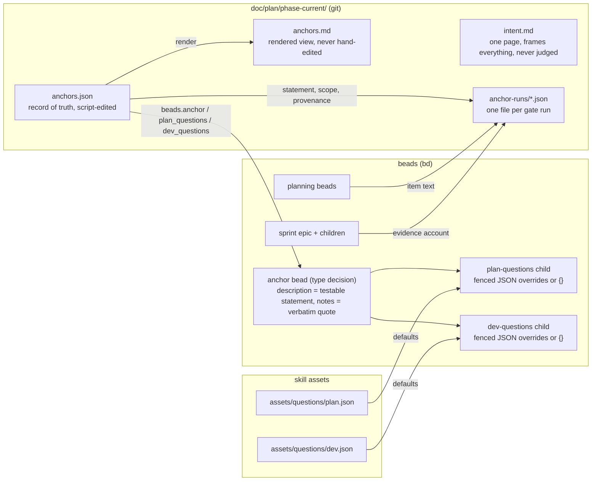
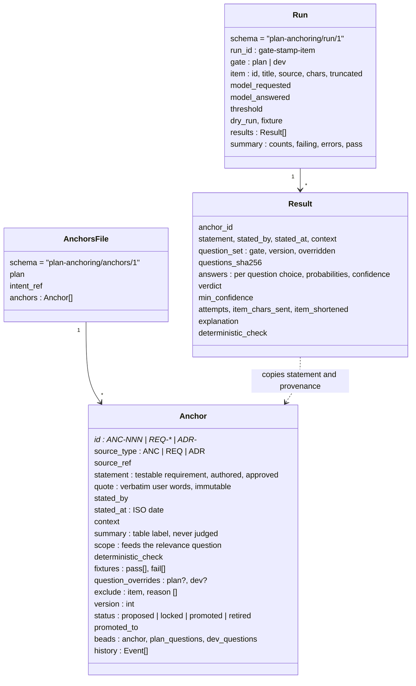
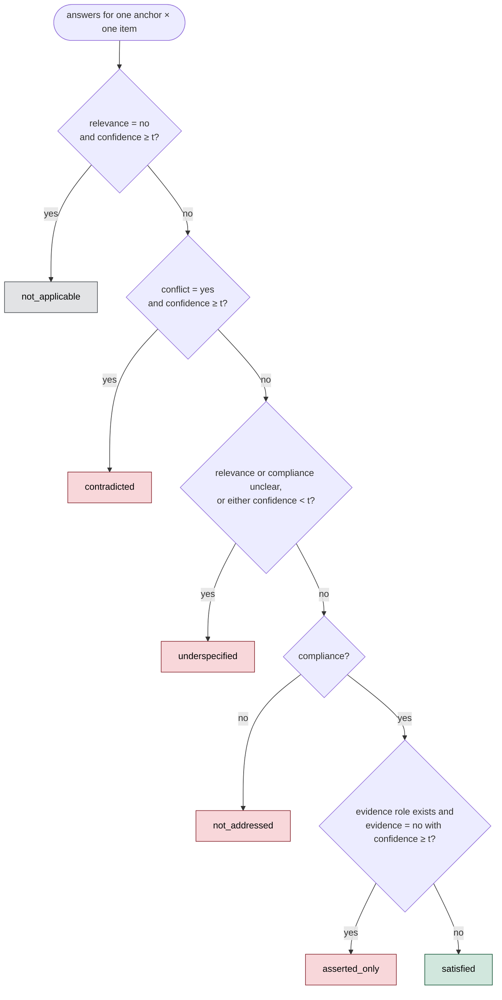
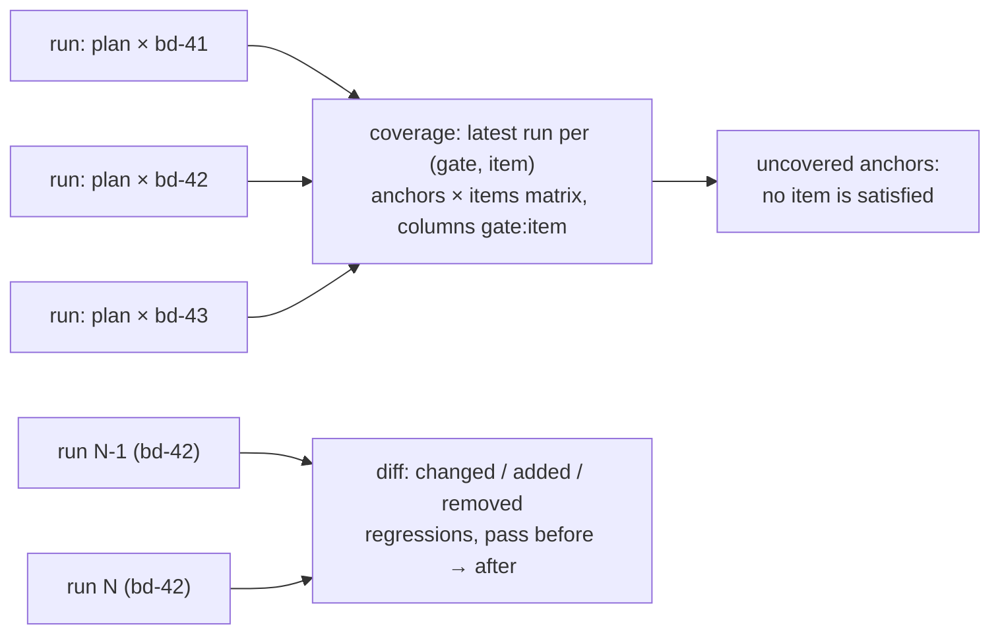
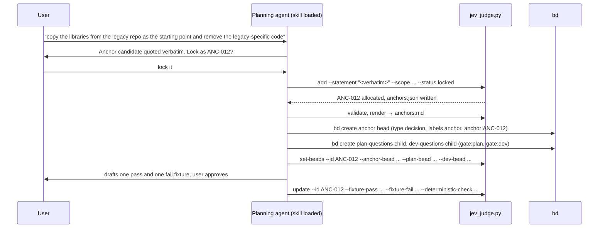

# Plan anchoring: data model, verdict gating and lifecycle

Companion to [architecture and call graphs](architecture-and-call-graphs.md). Covers what is stored, how independent Jev answers become one verdict, and how an anchor moves through its life.

## 1. Artifacts



The record is the single place to look: it holds every anchor and points at its beads. Beads point back only through labels (`anchor:ANC-012`). Runs copy the statement and provenance they judged, so an old run is self-describing even after the record moves on.

## 2. Anchor record



Rules that follow from the model:

- `quote` is immutable: the user's words. `statement` is the instrument Jev judges; it may be reworded for testability (`update --statement`), and every run file copies the statement it judged, so past verdicts keep their meaning. A changed directive is a new anchor; the old one is retired with `replaced_by` in its history.
- `version` bumps on statement, scope, summary, fixtures, overrides or status changes. `exclude` (items the anchor does not apply to, each with a reason) never bumps it: `judge` skips the cell with no Jev call and reports `excluded`, which passes.
- `ANC-NNN` is allocated by the script as max plus one and never reused. REQ and ADR anchors use their register ID so a report line points at the register directly.
- `summary` exists for tables; Jev never sees it. `scope` is sent, because it drives the relevance question.

## 3. What Jev sees

One anchor, one item, three or four questions. Nothing else.

```json
{
  "model": "jev-latest",
  "state": {
    "anchor": {"id": "ANC-012", "statement": "copy the libraries from the legacy repo as the starting point and remove the legacy-specific code", "scope": "the runtime crates sprint and any bead that creates the core library implementation"},
    "item": {"id": "bd-42", "title": "Sprint 2 runtime", "text": "# Sprint 2 runtime\n\n## Description\n..."}
  },
  "questions": {
    "relevant":     {"type": "choice", "instructions": "...", "criteria": {"yes": "...", "no": "...", "unclear": "..."}},
    "addressed":    {"type": "choice", "instructions": "...", "criteria": {"yes": "...", "no": "...", "unclear": "..."}},
    "contradicted": {"type": "choice", "instructions": "...", "criteria": {"yes": "...", "no": "...", "unclear": "..."}}
  }
}
```

| Gate | Question IDs | Roles |
| --- | --- | --- |
| plan | `relevant`, `addressed`, `contradicted` | relevance, compliance, conflict |
| dev | `relevant`, `implemented`, `violated`, `evidenced` | relevance, compliance, conflict, evidence |

Each question isolates one failure mode and says explicitly what it does not judge, because Jev answers them independently and cannot see its other answers. Wording of record is `assets/questions/{plan,dev}.json`; a question bead may override wording for one anchor but keeps the IDs and the `yes`/`no`/`unclear` options so the gating still applies.

## 4. Verdict gating

Jev returns a `choice` and a `confidence` per question. The script combines them with threshold `t` (default 0.6), evaluated top to bottom, first match wins.



Severity order for sorting and reports: `contradicted` > `not_addressed` > `asserted_only` > `underspecified` > `satisfied` > `not_applicable`. A run passes when no result is in the failing set or `error`. Contradiction outranks underspecification because a confident conflict is actionable even when relevance was shaky. `min_confidence` is reported so an anchor that is `underspecified` across many beads can be recognised as badly worded rather than the beads being vague.

What each verdict means for the caller:

| Verdict | Planning gate | Development gate |
| --- | --- | --- |
| `contradicted` | Bead proposes what the directive rules out: change the approach or escalate | Work went against the directive: block acceptance |
| `not_addressed` | Bead is silent on the directive: add its specific content | Account does not show the directive was followed: block until shown |
| `asserted_only` | n/a | Compliance claimed without evidence: get evidence or run the deterministic check |
| `underspecified` | Jev not confident: sharpen `scope` or the bead | Same, usually a vague sprint report |
| `satisfied` | Nothing | Run the paired deterministic check |
| `not_applicable` | Nothing, unless the anchor should have applied (scope too narrow) | Same |
| `excluded` | Nothing; Jev was not asked, the anchor's `exclude` names this item with a reason | Same |

Before editing on any failing verdict, the caller re-reads the exact text that was sent (the composed item file) at the point the anchor governs. If Jev looks wrong, the posted report says so with the reason and the user is asked, rather than rewording the bead until Jev agrees.

## 5. Coverage and diffs are computed, not asked



Jev cannot count or compare across beads, so "is ANC-012 satisfied anywhere" and "what did my edit change" are answered from run files by the script. An anchor that is `not_applicable` to every bead is reported as uncovered on purpose: either its scope is wrong or the plan lacks the bead that should carry it.

## 6. Anchor lifecycle

```mermaid
stateDiagram-v2
    [*] --> proposed : detected and quoted, not yet confirmed
    proposed --> locked : user confirms or says lock this
    proposed --> retired : never confirmed
    locked --> promoted : promote --adr ADR-NNNN (keeps ID, gains ADR ref)
    locked --> retired : directive changed or withdrawn; new anchor replaces it
    promoted --> retired : ADR superseded
    retired --> [*]

    note right of locked
        Judged at both gates.
        Statement immutable from here.
    end note
    note right of proposed
        Recorded so it survives
        context compression; not judged.
    end note
```



Only `locked` and `promoted` anchors are judged by `--all`; an explicit `--anchor` on a proposed or retired anchor is refused. Fixtures (`pass` and `fail` sentences) are drafted at lock time and approved by the user; `check-fixtures` judges them as items to confirm the question wording lands them where expected, and `--answers-file` fixtures exercise the gating offline in CI.

## 7. Capture, as a sequence



Capture is the one interactive step and stays in the main session. Nothing is locked without the user's confirmation. The statement proposed is a testable requirement that passed the rubric, not the quote; the quote is kept verbatim. After locking, the planner launches the independent higher-reasoning `anchor-tuning` subagent (Opus on Claude, Sol on Codex). It freezes an oracle from approved intent and anchors before its first Jev call, evaluates candidate questions without a plan-pass objective, and seals only protocol-validated production sets. The same identity later triages disputed review evidence without accepting a desired verdict.
